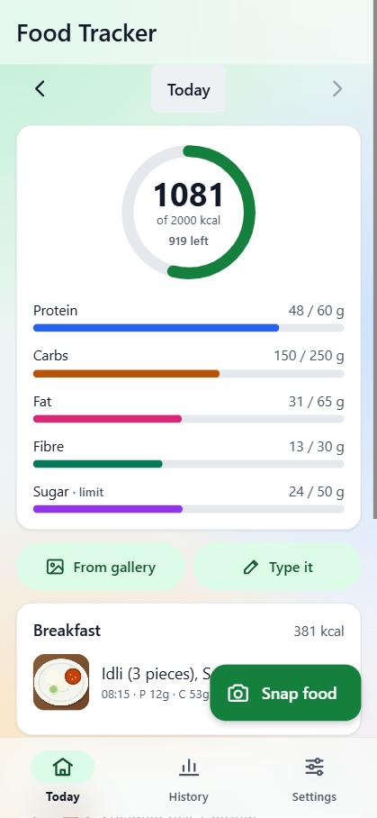
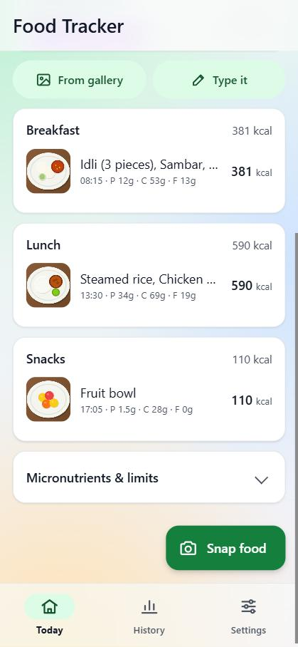
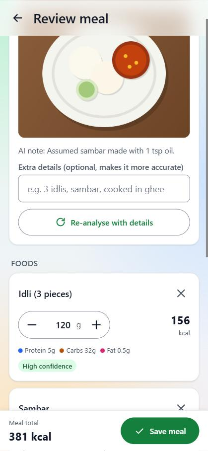
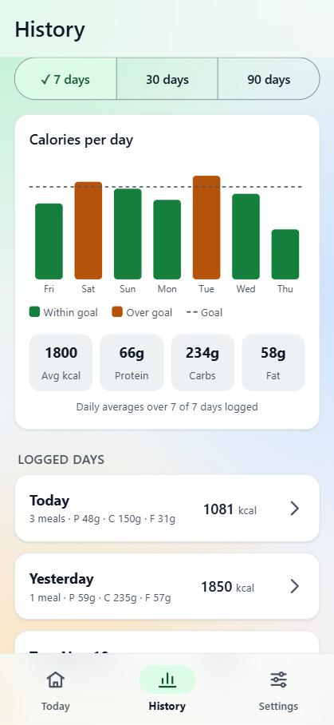
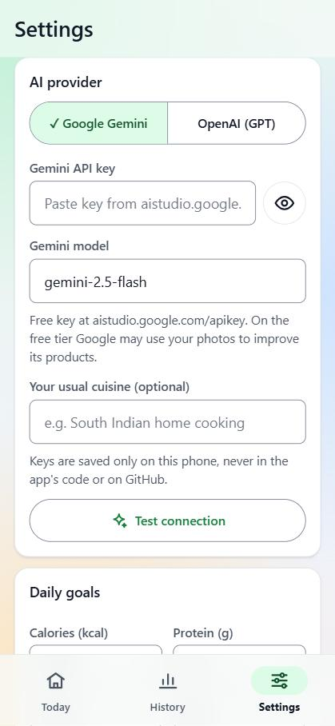
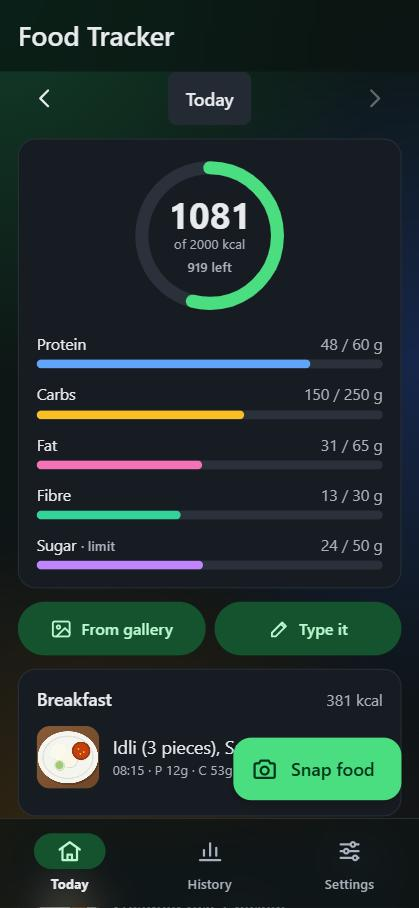

# Food Tracker

Take a photo of what you eat and get an estimate of the weight, calories, macros (protein, carbs, fat, fibre, sugar) and micronutrients (sodium, iron, calcium, vitamins…). It keeps a log for every day, with history charts.

- **Free:** hosted on GitHub Pages, using the free tier of the Google Gemini API.
- **Private:** meals are stored only on your phone (IndexedDB). There is no server or database.
- **Works offline** for viewing your log. Analysing a photo needs internet.
- **Two AI providers:** Google Gemini (free) or OpenAI GPT (paid). Switch between them in Settings.

> Photo estimates are approximate (often within 20–30%). Adjust the grams after each photo for better accuracy.

## Screenshots

| Today | Meals | Review a photo |
|:---:|:---:|:---:|
|  |  |  |
| **History** | **Settings** | **Dark mode** |
|  |  |  |

*Screens shown with sample data. Food photos are illustrations.*

## 1. Get a free Gemini API key

1. Go to https://aistudio.google.com/apikey and sign in with a Google account.
2. Click **Create API key** and copy it.
3. Paste it into the app under **Settings → Gemini API key**, then tap **Test connection**.

On the free tier, Google may use what you send (your food photos) to improve its products.

Optional: to use OpenAI instead, create a key at https://platform.openai.com/api-keys, paste it under **Settings → OpenAI (GPT)**, and choose that provider. OpenAI is pay-as-you-go.

API keys are saved only in your phone's browser storage. They are never in the code, so the GitHub repo can be public safely.

## 2. Put it online with GitHub Pages (free)

1. Create a new repository on GitHub, e.g. `food-tracker` (it can be public).
2. Push this folder to it:
   ```bash
   cd D:/food_tracker
   git init -b main
   git add .
   git commit -m "Food tracker app"
   git remote add origin https://github.com/<your-username>/food-tracker.git
   git push -u origin main
   ```
3. On GitHub, open the repo and go to **Settings → Pages → Build and deployment**. Choose **Deploy from a branch**, branch `main`, folder `/ (root)`, then **Save**.
4. After about a minute the app is live at `https://<your-username>.github.io/food-tracker/`.

To update the app later, run `git add . && git commit -m "..." && git push`.

## 3. Install it on your Android phone

1. Open the GitHub Pages link in **Chrome** on your phone.
2. Tap **⋮ → Add to Home screen → Install**.
3. Open it from the home screen. It runs full screen like a normal app. Allow camera access when asked.

## Using it

- **Snap food:** take a photo. The AI lists each item with its estimated grams. Adjust the grams with − / + or by typing, rename or remove items, then **Save meal**.
- **Extra details:** e.g. "3 idlis, cooked in ghee". Then **Re-analyse** for better accuracy.
- **Type it:** log food without a photo by describing it.
- **Tap a meal** to edit or delete it. Use **‹ ›** or tap the date to see other days.
- **History:** 7, 30 or 90-day calorie chart, averages and a list of days.
- **Settings → Daily goals:** set targets yourself, or use the calculator to work them out from your age, height, weight and activity.
- **Backup:** use **Backup (JSON)** regularly, and **Restore backup** on a new phone. **Export CSV** opens in Excel or Google Sheets.

## Running locally (optional)

```bash
python -m http.server 8765
```
Then open http://localhost:8765.

## Files

| File | Purpose |
|---|---|
| `index.html` | Screens: Today, Review meal, History, Settings |
| `app.js` | All logic: camera, AI calls (Gemini/OpenAI), storage, charts |
| `styles.css` | Mobile-first styling, light and dark mode |
| `manifest.json`, `sw.js`, `icons/` | Makes it an installable, offline-capable app |
